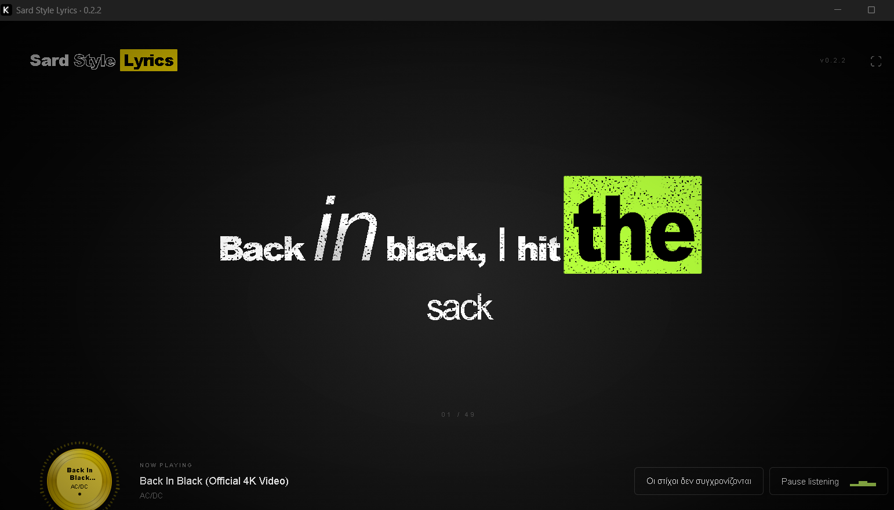

# Sard Style Lyrics

**Turn your music into moving typography.**

Sard Style Lyrics is a Windows desktop app that follows the song playing in your usual music player and brings its lyrics to life with expressive typography, smooth camera movements, and spray-inspired textures.

A spinning yellow vinyl and a reactive circular audio spectrum complete the experience.



*Preview using sample song metadata and original test lyrics.*

## Features

- **Automatic song tracking** through supported Windows media sessions.
- **Synchronized lyrics** fetched from LRCLIB, with local caching for previously loaded songs.
- **Expressive typography:** varied word sizes, bold and italic accents, hollow outlines, and yellow, lime, or red highlights.
- **Smooth camera movement** between phrases, with subtle motion blur that clears at rest.
- **Word-by-word entrances** and gradual fade-outs, with faster entrances for short phrases.
- **Spray-inspired textures**, a dark radial background, vignette, and subtle grain.
- **Spinning vinyl** displaying the track title and artist, surrounded by a circular spectrum driven by actual system-audio frequencies.
- **Fullscreen viewing** and respect for system reduced-motion preferences.

## Get started

1. Download the Windows ZIP from this repository's **Releases** page, when available.
2. Extract the entire ZIP. Keep `WebView2Loader.dll` beside the executable.
3. Open **Sard Style Lyrics.exe**.
4. Play a song in your usual music player. Listening and lyric lookup start automatically.

Requires Windows 10 version 1809 or later, or Windows 11, and the Microsoft Edge WebView2 Runtime. You do not need Node.js or Rust to run the portable app.

The current portable build is an unsigned development build with a production frontend.

## Controls

| Control | Action |
| --- | --- |
| Move the pointer | Reveal the playback controls |
| **F** | Toggle fullscreen |
| **Escape** | Leave fullscreen |
| **Pause listening** | Stop the app's listening session without pausing your external player |
| **Οι στίχοι δεν συγχρονίζονται** | Try another available set of synchronized lyrics for the same song |

The vinyl remains visible when the controls hide. Its center label stays readable while the record rotates.

## How synchronization works

The app reads the current track and playback position from Windows media sessions. It retrieves timed lyrics from [LRCLIB](https://lrclib.net) and follows the player's pauses, seeks, and song changes.

Enhanced LRC and Lyricsfile word timestamps are supported. When a source only provides line timestamps, word timing is estimated within each line. Exact vocal alignment depends on the lyric source and the player's timeline.

Some players do not expose a usable playback position. In that case, the app waits for synchronization rather than inventing a timeline. Lyrics also depend on database coverage and service availability.

The app visualizes music from your existing player; it does not stream or download tracks.

## Audio and privacy

- Audio visualization uses **WASAPI loopback**, capturing the Windows output rather than the microphone.
- Small audio-analysis buffers stay in memory; captured audio is not written to disk.
- Track metadata is sent to LRCLIB for lyric lookup. Successfully matched lyrics are cached locally.
- An optional recognition gateway is available for developers. It is disabled unless explicitly configured, and sends audio to the configured gateway when enabled. No gateway credentials are included.

The spectrum represents the system output mix, which may include other applications.

## Built with

| Part | Technology |
| --- | --- |
| Desktop application | Tauri 2 and Rust |
| Interface | React and TypeScript |
| Typography and visual effects | CSS and SVG |
| Circular audio spectrum | Canvas with native frequency analysis |
| Windows integration | WASAPI loopback and Windows media sessions |
| Frontend tooling | Vite and Vitest |

## Development

Install:

- Node.js 22.12 or newer and npm.
- Rust stable with the Windows MSVC toolchain.
- Visual Studio C++ Build Tools with the **Desktop development with C++** workload and a Windows SDK.
- Microsoft Edge WebView2 Runtime.

See the [Tauri prerequisites](https://v2.tauri.app/start/prerequisites/) for setup instructions.

From the project root:

```powershell
npm ci
npm run tauri dev
```

Running `npm run dev` alone starts the browser frontend. System-audio capture and Windows media-session tracking require the desktop app.

### Build

```powershell
npm run tauri build -- --no-bundle
```

The executable is generated at `src-tauri/target/release/kinetic-live.exe`. The internal build name retains the project's original name; the application is branded **Sard Style Lyrics**.

To build the configured installer as well:

```powershell
npm run tauri build
```

### Tests

```powershell
npm test
npm run build
npm run test:ui
```

The browser integration suite requires Google Chrome and uses synthetic metadata and original test lyrics. These fixtures are not a demo mode in the app.

Native spectrum checks:

```powershell
cargo test --manifest-path src-tauri/Cargo.toml spectrum_tests
```

### Service configuration

See `.env.example` for configuration names. Before distributing a build, set `VITE_LRCLIB_CONTACT` for browser builds and `KINETIC_LRCLIB_CONTACT` for the native app to your project homepage or contact address.

Optional recognition uses the native process variables `KINETIC_RECOGNITION_URL` and `KINETIC_RECOGNITION_TOKEN`. Keep credentials out of source control and out of `VITE_` variables, which are exposed to the frontend.

## Project structure

```text
src/
  App.tsx              Application interface
  Visualizer.tsx       Lyric scene and camera
  Vinyl.tsx            Vinyl and circular spectrum
  engine/              Camera, typography, layout, and timing
  hooks/               Automatic playback-session tracking
  lyrics/              Metadata normalization and lyric parsing
  services/            Native bridge, lyric lookup, and cache
  tests/               Unit tests
src-tauri/
  src/                 Native audio and Windows integration
scripts/               Integration checks
```

## Contributing

Issues and pull requests are welcome. For playback or synchronization problems, include your Windows version, music player, track metadata, and steps to reproduce the issue.

Please avoid uploading credentials, private logs, cached lyrics, or third-party song recordings.

## License

A license has not yet been added to this repository.
